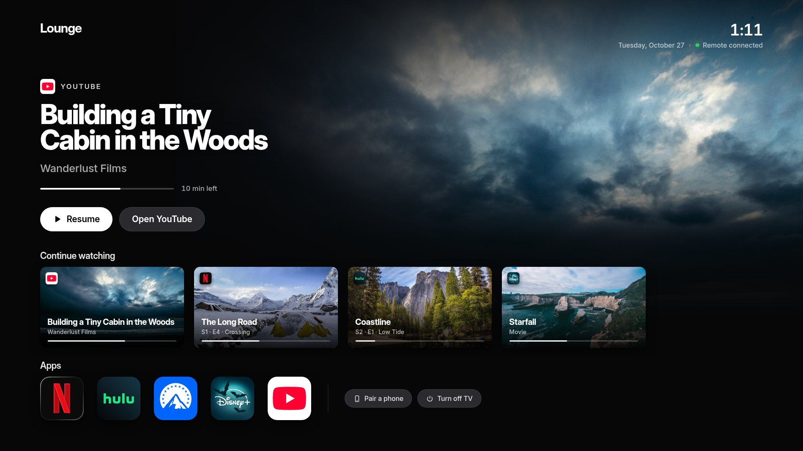
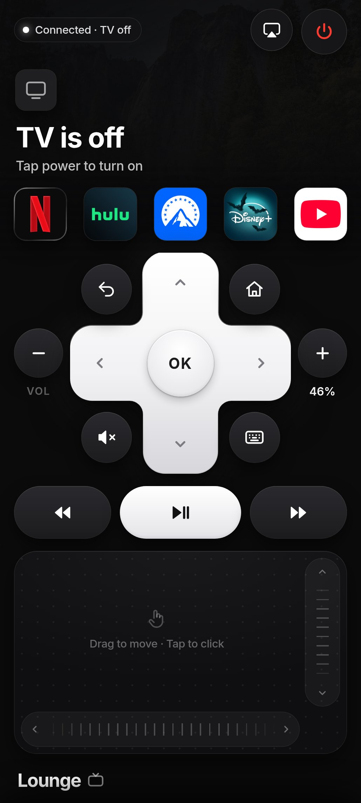
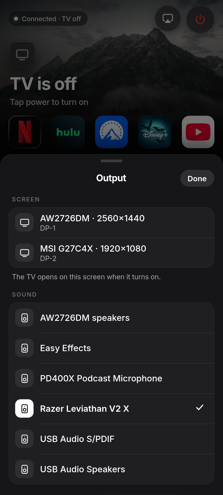

# PocketPC 📱➜🖥️

**PocketPC** puts your whole PC in your pocket. Its TV app, **Lounge**, turns a Linux PC into a TV and your Android phone into its remote.

Netflix, Hulu, Paramount+, Disney+ and YouTube run full screen in a kiosk Chrome window. A
small Rust server drives it, and the phone talks to the server over Wi-Fi. You don't need a
streaming stick, a cable or a TV OS.

<p align="center">
  
</p>

<p align="center">
  
  &nbsp;
  
</p>

<p align="center">
  
</p>

## What it does

- **A TV home screen.** It has a Continue watching row, picked up automatically from whatever
  you watch, plus one-press launchers for each service.
- **A phone remote.** It has a D-pad, volume, play/pause and seek, a trackpad with scroll
  strips, and a keyboard for search boxes. It shows what's playing, with artwork and progress.
- **D-pad navigation on any site.** An injected script moves a focus ring around the page like
  a TV app does. While a video plays, ◀ ▶ seek and OK pauses.
- **Choose the screen and speakers.** Pick which monitor shows the TV and which audio device
  plays it, straight from the phone. It uses KWin and PipeWire.
- **A screensaver.** Landscape photos with a slow pan and a big clock. When a show is paused,
  it shows the show's poster instead.
- **A connection that holds up on bad Wi-Fi.** Some routers silently drop long-lived
  connections. The remote rotates its websocket every 20 s without a gap, and the server acks
  each press so a press is never lost or doubled.
- **Fast app switching.** One app tab stays open and is frozen while hidden, so going back to
  it is instant and RAM stays low.
- **Ad blocking.** uBlock Origin Lite is installed into the TV browser automatically and kept up
  to date. It's switched off on the paid services so it can't break their players.
- **Quiet Chrome.** No "Restore pages?", no save-password or notification prompts, and no
  swipe-to-go-back.

## How it works

```
 phone (WebView app)  ──ws──▶  lounge server (Rust, axum)  ──CDP──▶  Chrome --kiosk
                                   │                               (streaming sites + couch.js)
                                   ├─ wpctl / pw-dump   → volume, speakers
                                   └─ KWin script       → which monitor
```

Presses become real input through the Chrome DevTools Protocol, so this works on Wayland. Chrome
uses its own profile, so you sign in to each service once.

## Run it

You need Linux with KDE Plasma (for moving windows between screens), PipeWire, Google Chrome
and Rust.

```sh
cargo build --release
./target/release/couchtv               # open the TV and show a pairing QR code
./target/release/couchtv --no-launch   # server only; turn the TV on from the phone
./target/release/couchtv --autostart   # start the server at login
```

The server listens on port 7777 by default (`--port N` to change it).

### The phone app

`android/` is a tiny WebView app built with plain SDK tools (no Gradle):

```sh
android/build.sh   # needs ANDROID_HOME with build-tools 36 and platform 36
```

The PC also serves the APK at `http://<pc>:7777/couchtv.apk`. Pair by scanning the QR code on
the TV or by typing the code shown there. The remote also works in a phone browser at
`/remote`.

### Files

| What | Where |
|---|---|
| Pairing token (delete it to unpair every phone) | `~/.config/couchtv/token` |
| Chrome profile | `~/.local/share/couchtv/chrome` |
| Watch history | `~/.local/share/couchtv/recent.json` |
| Screensaver photos (any `.jpg`) | `~/.local/share/couchtv/saver/` |
| Log | `~/.local/state/couchtv/couchtv.log` |
| Ad blocker (uBlock Origin Lite) | `~/.local/share/couchtv/ublock/` |

## Notes

This is a personal project made for one living room, so expect rough edges. The service icons
in `web/icons/` belong to their owners and are used only to label the launch buttons. Lounge
isn't affiliated with any of those services.
